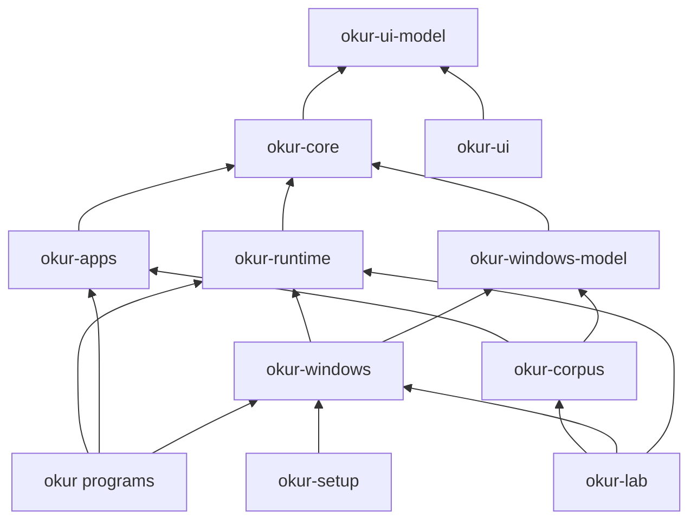

# Crate Structure: Review and Proposal (2026-11-02)

**Status**: accepted by the owner (2026-11-03), with the default answer to each question of
section 12. Steps 0 to 3 are built first
([`2026-11-02-windows-ui-round-2.md`](../plans/2026-11-02-windows-ui-round-2.md)).
**Why**: the owner, 2026-11-02: before any cross-platform work, the workspace needs a
refactoring; "okur-core contains windows-specific and application code", and the crates have
no discipline.
**Read with**: [`AGENTS.md`](../../AGENTS.md) §1.3 and §6,
[`extension-sdk-proposal.md`](extension-sdk-proposal.md) (milestones M2 and M4),
[`helper-ui-architecture.md`](helper-ui-architecture.md),
[`crates/xa11y/VENDORED.md`](../../crates/xa11y/VENDORED.md).

Figures were taken on the working tree at `c6debc2c`. Another session had uncommitted edits in
`native_focus.rs` and `event_trace.rs` at the time, so line counts drift by a few dozen lines.

## 1. Summary

- `okur-core` has no `windows` dependency and no `cfg(target_os)` at all. Its problem is
  content, not compilation: 13 application modules (Word, Excel, the Windows shell, Google
  Docs) live in it, and the engine calls Word and Excel directly in 84 places instead of
  through the `AppModule` trait.
- A Word or Excel feature cuts through four layers. Of the 63 commits since 2026-10-19 that
  touched the Word or Excel modules, 47 also touched the engine, 36 `okur-platform`, and 33
  `event.rs` or `actions.rs`.
- `okur-platform` is one Windows crate holding six different things: the live driver, pure
  converters of Windows data, platform-neutral runtime code, lab-only tools, installer
  plumbing, and Office object-model readers. It also defines the `KeyboardHook`,
  `AccessibilityEventListener` and `TtsEngine` traits, so a macOS crate would have to depend
  on the Windows crate to implement them.
- Parity replay (`okur-corpus`) depends on the whole of `okur-platform` for about 4,000 lines
  of pure conversion code. That keeps parity off the macOS and Linux CI job, which tests only
  `okur-core` and `xa11y-core`.
- Proposal: three new crates (`okur-apps`, `okur-runtime`, `okur-windows-model`), one rename
  (`okur-platform` to `okur-windows`), lab code moved into `okur-lab`, and a layer check on
  `cargo metadata` run in the gate and in CI. The migration has a baseline step and seven
  steps after it. The large behavioral one, step 5, is the first half of SDK milestone M2.

## 2. How the figures were made

| Id | Command (run from the repository root) | Measures |
|---|---|---|
| C1 | `cargo metadata --no-deps --format-version 1` | targets, binaries, declared dependencies |
| C2 | `find crates/<c> -name '*.rs' \| xargs cat \| wc -l` | lines of Rust per crate |
| C3 | per file: lines before the first inline `#[cfg(test)] mod … {` count as production; `tests.rs`, `*_tests.rs` and `tests/` count as test | production and test lines (approximate) |
| C4 | `rg -c '(cfg!?\(\|cfg_attr\().*(windows\|target_os\|unix)' crates/<c> --type rust` | platform `cfg` sites |
| C5 | `rg -c 'windows::\|windows_core::\|windows_future::' <file>` | direct `windows` crate use |
| C6 | `cargo tree -p <c> -e normal --prefix none --offline \| sort -u \| wc -l` | transitive normal dependencies |
| C7 | `rg -o 'apps::windows::[a-z_]+' crates/okur-core/src -g '!**/apps/**'` and `rg -c '\bword::' crates/okur-core/src/editing.rs` | engine references into application modules |
| C8 | `git log --since=2026-10-19 --format='' --name-only -- crates`, grouped by folder | which files change |
| C9 | for each commit touching `apps/windows/{word,word_ribbon,word_dialog,excel}.rs` since 2026-10-19: `git show --name-only` | co-change |
| C10 | `rg -c 'IUIAutomation' crates/okur-platform/src` | raw UI Automation outside xa11y |
| C11 | `rg -c '#\[test\]' crates/<c>` | unit tests |
| C12 | `name:` lines inside `pub struct ScreenReaderEngine` (`engine.rs:130-582`) | engine state fields |

No build, test or clippy run was made: the machine was shared, and the brief forbade them.
Compile-time effects are therefore not claimed anywhere below; step 0 measures them.

## 3. The workspace today

### 3.1 Crate map

| Crate | Purpose | Rust lines, prod / test (C2, C3) | Builds (C1) | Internal deps (C1) | Used by | Transitive deps (C6) |
|---|---|---|---|---|---|---|
| `okur-ui-model` | messages between Okur and `okur-ui` | 511 / 110 | lib | none | core, platform, ui | 12 |
| `okur-core` | engine, buffer, cursors, speech rendering, dialog logic, settings model, **app modules** | 52,237 / 25,862 | lib, 2 examples | ui-model | platform, corpus, okur, lab | 42 |
| `okur-platform` | everything Windows (see 5.2) | 25,646 / 4,555 | lib | core, ui-model, xa11y, xa11y-windows; `windows` (45 features), tokio, toml | corpus, okur, lab, setup | 90 |
| `okur-corpus` | parity replay, manifest, invariants, divergences, latency | 5,651 / 1,621 | lib | core, platform | lab | 98 |
| `okur` | the reader's runtime as a library, plus its programs | 2,228 / 572 | lib; bins `okur`, `okur-sr`, `okur-sr-no-uiaccess` | core, platform | lab | 113 |
| `okur-lab` | harness programs | 3,240 / 172 | bins `okur-lab`, `okur-lab-keys`, `okur-lab-notify-probe` | okur, core, corpus, platform | none | 125 |
| `okur-setup` | installer | 770 / 509 | lib; bin `okur-setup` | platform | none | 91 |
| `okur-ui` | Win32 renderer of Okur's dialogs | 4,840 / 282 | bin `okur-ui` | ui-model; `windows` (13 features) | none (a process) | 25 |
| `okur-speech-recorder` | SAPI 5 voice that logs JAWS's speech (lab) | 369 / 145 | cdylib + rlib | none; `windows` | none | n/a |
| `xa11y`, `-core`, `-windows`, `-macos`, `-linux` | vendored accessibility layer | 19,318; 16,449; 9,848; 7,207; 10,033 total | lib, bin `xa11y` | see VENDORED.md | platform | 28 (core) |

The MSIX package builds `-p okur --bin okur-sr --bin okur-sr-no-uiaccess` and `-p okur-ui`
(`packaging/msix/build-msix.ps1:67-69`).

### 3.2 Dependencies today

```
okur-lab ──> okur ──> okur-platform ──> okur-core ──> okur-ui-model
   │                      ^    ^            ^
   ├──> okur-corpus ──────┘    │            │
   └──────────────────────────(all four)────┘
okur-setup ──> okur-platform
okur-ui ──> okur-ui-model
```

## 4. The 2026-10-15 structure round: done and not done

[`2026-10-15-structure-for-macos-and-extensions.md`](../plans/2026-10-15-structure-for-macos-and-extensions.md)
worked inside `okur-core`. It did not touch the crate structure.

| Step | Then | Now |
|---|---|---|
| 1. `Command` values, one key map | done (`0a94da5`) | still holds (`Command::from_name`, `command.rs:467`); not re-audited here |
| 2. No Win32 class or process name in `okur-core` outside `apps/` | done (`6185a8e`) | three class names are back in general code: `"#32768"` (`engine/focus.rs:14`), `"bosa_sdm_"` (`native_focus.rs:700`), `"ToggleSwitch"` (`native_focus.rs:567`) |
| 3. `AppModule`; "the engine has no `if app == ...` branches" | done for 7 modules (`2fc61b5`) | 13 modules now. Word and Excel, added from 2026-10-24, are reached directly (section 6). `AppMode` still has `NativeDesktop`, `NativeShell` and `NativeExplorer` (`engine/state.rs:6-13`). Command handling in modules moved to SDK M2 and is not done. |
| 4. Announcements as data | partial | role marks are still written by hand in 73 places in 15 production files (`speech.rs` 33, `word.rs` 9, `cursor.rs` 7, …) |
| 5. Separate fixes | 2 done | not re-checked |
| macOS backend | "later" | `hook/macos.rs` (44 lines) and `events/macos.rs` (45 lines) are stubs. There is no macOS speech, actions or clock. |

## 5. Platform-specific code

### 5.1 `cfg` sites and `windows` use per crate (C4, C5)

| Crate | `cfg` sites | Files with them | Notes |
|---|---|---|---|
| `okur-core` | 0 | 0 | no `windows` dependency |
| `okur-platform` | 218 | 33 | largest: `tts/sapi5.rs` 36, `process.rs` 31, `actions.rs` 24 |
| `okur-lab` | 48 | 3 | `main.rs` 44 |
| `okur-ui` | 8 | 1 | renderer is Windows-only; it drains stdin elsewhere |
| `okur` | 7 | 3 | `run.rs` 5 |
| `okur-setup`, `okur-speech-recorder` | 2 each | | |
| `okur-corpus`, `okur-ui-model` | 0 | 0 | |

Direct `windows` crate use in `okur-platform` by file (C5): `event_trace.rs` 91,
`text_context.rs` 78, `actions.rs` 55, `harness.rs` 53, `uia_snapshot.rs` 30, `process.rs` 23,
then 30 smaller files. Raw `IUIAutomation` appears 250 times in 8 files (C10):
`text_context.rs` 74, `uia_snapshot.rs` 68, `event_trace.rs` 36, `window_text.rs` 23,
`uia_probe.rs` 21, `actions.rs` 21. That is a second UI Automation layer beside
`xa11y-windows`. VENDORED.md's phase 4 planned to fold it into xa11y; that has not been done.
The xa11y facade's tree-to-AOM path (`bridge.rs`, 182 lines) runs only when the platform is not
Windows (`okur/src/run.rs:709`).

### 5.2 What `okur-platform` holds

Approximate lines from C2 and the files' own `cfg` boundaries:

| Kind | Modules | Lines, tests included | Needs `windows`? | Who uses it |
|---|---|---|---|---|
| Live Windows driver | `hook/windows`, `events/windows`, the live part of `actions` (`capture_foreground_page`, `sheet_place_now`, clipboard, mouse), `event_trace::capture` (`event_trace.rs:2957-5933`), the capture part of `uia_snapshot` (`:456-1769`), `text_context`, `window_text`, `screen_lines`, `mouse_point`, `top_windows`, `virtual_desktop`, `notification_listener`, `ocr`, `file_text`, `tts/sapi5`, `tts/onecore`, `sound`, `clock` | ~13,600 | yes | `okur` |
| Office object models | `word_om`, `excel_om`, plus Office-specific functions in `text_context` (19), `event_trace` (17), `actions` (10) | 1,627 + parts | yes | `okur`, lab |
| Pure converters of Windows data | `event_trace.rs:1-2948` (`TraceEvent`, `EventConverter`, `focus_event_from_trace`), `uia_snapshot.rs:1-455` (`to_aom`), `ia2_snapshot` but its 40-line capture, `privacy`, `actions::{runtime_id, unique_id}` | ~6,200 (~4,100 production) | no | live listener **and** parity replay |
| Platform-neutral runtime | `tts/mod` (`TtsManager`, `TtsEngine`), `tts/thread` (speech thread), `tts/no_speech`, `settings_file`, `ui_host`, `bridge`, the hook and event traits and their mocks | ~4,050 | one COM init (`tts/thread.rs:181`) | `okur` |
| Lab-only tools | `harness` (key chords, JAWS history), `uia_probe`, `audio` (sound meter for `wait-silence`), and about 300 lines of probes in `actions.rs` that only `okur-lab` calls (`text_attributes_now`, `read_text_now`, `document_*_now`, `status_bar_now`, `perform_now`, `tray_icons_now`, `taskbar_dump_now`) | ~1,900 | yes | `okur-lab` only |
| Installer and session plumbing | `registry`, `elevation`, `signature`, `ease_of_access`, `start_options`, `instance`, `process`, `desktop`, `lowered_process` | ~2,800 | yes | `okur`, `okur-setup` |

These modules compile on every platform because each function carries its own
`#[cfg(windows)]` and `#[cfg(not(windows))]` stub. Whether the crate really builds on macOS or
Linux is unknown: no CI job has ever built it there.

### 5.3 Windows content in `okur-core` (no `cfg`, but Windows in behavior)

- **`apps/windows/`**: 12 modules (`desktop`, `excel`, `explorer`, `search`, `settings`,
  `task_switcher`, `taskbar`, `terminal`, `widgets`, `word`, `word_dialog`, `word_ribbon`).
  3,529 production lines and 2,349 test lines (C3).
- **`event.rs`**: `PlatformIds` holds Win32 classes and the UIA automation id, by design. 10 of
  the 37 `AccessibilityEvent` variants are Word or Excel answers (`DocumentHeadings`,
  `DocumentLinks`, `LineSpacing`, `WordKeyState`, `DocumentFields`, `DocumentNotes`,
  `DocumentParagraphs`, `DocumentView`, `SheetPlace`, `SheetList`). Several of `FocusEvent`'s
  73 fields are described in Win32 terms (`plain_edit`, `rich_edit`, `dialog_text` for
  `#32770`, `in_ribbon` for NetUI).
- **`actions.rs`**: 17 of the 45 methods of `ApplicationActions` read or move in Word or Excel
  (from `move_to_cell` to `move_to_paragraph`, all but `read_status_bar`).
- **The engine**: 22 of `ScreenReaderEngine`'s 200 fields (C12) are Word or Excel state
  (`sheet_asks`, `sheet_titles`, `revisions_asked`, `word_read_mode`, …). `AppMode` has three
  Windows-shell variants.
- **Class literals in general code**: the three in section 4.
- **Settings**: `Synthesizer` is a closed enum of Windows synthesizers (`settings.rs:481`).
  SDK M6 replaces it with a driver registry.

### 5.4 Why CI tests only two crates on macOS and Linux

`.github/workflows/ci.yml:88` runs `cargo test -p okur-core -p xa11y-core`, informational
only (`continue-on-error: true`).
- `okur-platform` is the Windows driver. It has never been built there.
- `okur-corpus`, and with it the parity test, depends on `okur-platform`.
- `okur`, `okur-lab`, `okur-setup`, `okur-ui` and `okur-speech-recorder` are Windows programs.

Only the pure converters (section 5.2) keep parity on Windows, and they need no `windows` call.

## 6. Application-specific code

| Application | Engine side (`okur-core`) | Platform side (`okur-platform`) | How it reaches the engine |
|---|---|---|---|
| Word | `word.rs`, `word_ribbon.rs`, `word_dialog.rs`: 1,981 prod / 1,501 test | `word_om.rs` (1,075), Word parts of `text_context`, `actions`, `event_trace` | `AppModule`, **plus** 41 direct paths from outside `apps/` and 14 `word::` calls in `editing.rs` |
| Excel | `excel.rs`: 818 / 426 | `excel_om.rs` (552), parts of `actions` | `AppModule`, **plus** 29 direct paths from outside `apps/` (one in a test) |
| Windows shell | 8 modules: 730 / 422 | window classes in `event_trace` (`Progman`, the taskbar, NetUI) | `AppModule`, and 3 `AppMode` variants |
| Google Docs | `apps/web/google_docs.rs`: 128 / 135 | none | `AppModule` (`owns_page`) |
| Chrome / web | general code (`linearize`, `engine/page.rs`), as it should be | IA2 and UIA snapshots, Chromium classes in `event_trace` | general code |
| WhatsApp, Outlook | none (mentioned only in comments and tests) | none | none |

Direct engine references into application modules (C7): 70 `apps::windows::*` paths (Word 41,
Excel 29) in 7 files (`engine.rs` 30, `engine/commands.rs` 25, `engine/text_feedback.rs` 8, `engine/focus.rs`
3, `engine/say_all.rs` 2, `editing.rs` 1, `engine/tests.rs` 1), plus the 14 `word::` calls in
`editing.rs`. That is 84 in all, 83 of them in production code. `editing.rs` is used by
`linearize.rs` and `cursor.rs`, so Word code sits on the virtual buffer's dependency path.

Churn since 2026-10-19 (C8, files touched per commit, 619 commits): `okur-core` engine 617,
other `okur-core` 601, `okur-platform` 394 (100 of them `event_trace.rs`), `okur-corpus` 245,
`okur-core/src/ui` 159, `engine/tests.rs` 139, `okur-core/src/apps` 132. Most change happens
inside the engine itself, so moving the applications out would save little compile time. Its
value is the boundary.

## 7. Layering problems

1. **Application behavior leaks into the engine** (section 6). The `AppModule` contract exists,
   but the Word and Excel rounds added a parallel path beside it: engine fields, event variants
   and action methods.
2. **Port traits sit in the Windows crate.** `KeyboardHook` (`hook/mod.rs:14`),
   `AccessibilityEventListener` (`events/mod.rs:12`) and `TtsEngine` (`tts/mod.rs:34`) are
   defined in `okur-platform`. AGENTS.md §1.3 wants them in a platform-neutral crate.
   `PlatformBridge`, which §1.3 names as a trait, is a struct (`bridge.rs:36`).
3. **Neutral logic is held hostage by Windows.** The speech thread, settings files, the UI host
   and the conversion of Windows events and snapshots are platform-neutral code, but they live
   in the crate that needs `windows`. So none of it, parity included, is tested off Windows.
4. **Lab code in the product's crate.** `harness.rs` (key chords sent to other programs, JAWS's
   speech history), `uia_probe.rs`, `audio.rs` and the lab's probes in `actions.rs` are in
   `okur-platform`,
   which `okur.exe` links. The linker drops what the reader does not call, but nothing checks
   it. The separation that `okur-lab`'s manifest promises (its `Cargo.toml` header) is a
   convention only.
5. **`okur-lab` depends on `okur`**, the reader's program crate, for `load_aom_from_path` and
   `init_logging` (`okur-lab/src/main.rs:12, 754`).
6. **God modules.** `ScreenReaderEngine` has 200 fields, held across 32 files of
   `impl ScreenReaderEngine` (C12). 17 files have more than 1,500 production lines (C3), led by
   `event_trace.rs` (5,933: trace format, Windows-to-engine conversion and the live capture in
   one file), `engine.rs` (3,931), `cursor.rs` (3,896), `engine/commands.rs` (2,070) and
   `okur-lab/src/main.rs` (2,019: every lab subcommand).
7. **Re-export layers.** `okur-platform` re-exports `okur-core` types (`hook/mod.rs:8`,
   `events/mod.rs:8`, `lib.rs:42-53`), so the same type has two paths.
8. **Duplicated concepts, minor.** Three converters to `AomNode` (`bridge.rs`, `uia_snapshot::to_aom`,
   `ia2_snapshot::ia2_to_aom`). Chord text is parsed in `okur-corpus/src/keys.rs`,
   `okur-lab/src/aria_at.rs` and `okur-ui/src/dialog.rs`.
9. **Test doubles in production modules.** `RecordingActions` (`okur-core/src/actions.rs:413-829`)
   and `MockSpeechOutput` are needed by parity replay, so they cannot be `cfg(test)`. That is
   acceptable; they could sit in a clearly named `replay` module.

## 8. How tests and parity depend on the engine

Any restructure must keep these working, unchanged:
- **Parity** (`okur-corpus/src/lib.rs:60`, `jaws_parity_matches_baseline`) replays the
  scenarios of `corpus/scenarios/` (1,915 files, `ls corpus/scenarios | rg -c '\.json$'`) against `corpus/parity-baseline.json` (generated: 11,383 of 11,955 steps match, 365
  accepted divergences). It builds a `ScreenReaderEngine`, whose constructor installs the
  application modules itself (`engine.rs:777`, `apps: crate::apps::builtin()`). It speaks into
  `RecordingSpeech` (`parity.rs:879`) and acts into `RecordingActions`.
- **Replay uses the live converter.** Traces go through
  `okur_platform::event_trace::{read_trace, EventConverter}` (`okur-corpus/src/lib.rs:587, 623`;
  `parity.rs:14`), and the live listener uses the same `EventConverter`
  (`events/windows.rs:9`). Snapshots go through `uia_snapshot::to_aom` and
  `ia2_snapshot::ia2_to_aom` (`okur-corpus/src/snapshots.rs:8-9`), the functions the live page
  read uses (`actions.rs:1556-1568`). Keeping one code path for live and replay is what makes
  parity mean something. The proposal keeps it.
- **Engine unit tests**: 187 tests in `engine/tests.rs` (630 in `okur-core` in all, C11) use
  private engine state (23 direct field assignments), so they stay inside `okur-core`. 20 of
  them involve Word or Excel.
- **The catalog test** (`okur-core/tests/catalog.rs:44`) scans source folders by crate name
  (`CHECKED = ["okur-core", "okur-ui"]`). `tests/literals.txt` has 47 entries keyed by
  `okur-core/src/apps/...` paths. Both must follow any move.
- **Log targets are crate names.** The debug-log filter in `okur/src/run.rs:155` is
  `"okur_core=debug,okur_platform=debug,okur=debug"`, and `okur-lab latency` reads those logs. A
  rename must update the string, or the latency tool silently loses its speech timings.

## 9. Target layout

### 9.1 Crates and their rules

| Crate | Single responsibility | May depend on | Must not |
|---|---|---|---|
| `okur-ui-model` | the dialog protocol | serde | any other okur crate |
| `okur-core` | the engine: key routing, cursors, buffer, focus reading, speech rendering, dialog logic, settings model; **every port trait the engine calls**; the app-module contract (later `okur-ext`) | `okur-ui-model` | application knowledge, `tokio`, `windows*`, any `cfg(target_os)` |
| `okur-apps` (new) | application modules: `windows/` (Word, Excel, shell), `web/` (Google Docs), later `macos/`. Plain Rust, compiled and tested on every platform. | `okur-core` | platform crates, runtime, `cfg(target_os)` |
| `okur-runtime` (new) | what runs the engine the same way on every OS: the event loop, the speech thread and `TtsManager`, settings files, the UI host process, logging; the `KeyboardHook`, `EventSource` and `TtsEngine` traits with their mocks; a `Platform` struct of trait objects | `okur-core`, `okur-ui-model`, `xa11y` (facade) | platform crates, `windows*`, `cfg(target_os)` |
| `okur-windows-model` (new) | Windows data as data: trace and snapshot types, `EventConverter`, `to_aom`, `ia2_to_aom`, privacy redaction. Live and replay share it. | `okur-core`, `xa11y-windows` (only for `Ia2Node`) | `windows*` directly, `cfg(target_os)` |
| `okur-windows` (renamed `okur-platform`) | the live Windows driver: hook, events, actions, SAPI and OneCore engines, OCR, Office object models, installer plumbing. Gated once, at its root (`#![cfg(windows)]`). | core, runtime, windows-model, ui-model, xa11y, xa11y-windows, `windows` | `okur-apps`, lab crates |
| `okur-macos` (later) | the same for macOS | as `okur-windows` | |
| `okur-corpus` | parity and corpus tools | core, apps, windows-model | `okur-windows`, `okur-runtime` |
| `okur` | thin programs: `okur`, `okur-sr`, `okur-sr-no-uiaccess`. The composition root: picks the platform crate by `cfg` and passes `okur_apps::builtin()` to the runtime; Windows start-up (instance lock, secure desktop, UI Access) in one `windows.rs` | runtime, apps, core, `okur-windows` (cfg windows) | lab crates |
| `okur-lab` | every lab program and every lab-only tool, including `harness`, `uia_probe`, the sound meter and the probes | anything | being depended on |
| `okur-setup`, `okur-ui`, `okur-speech-recorder`, `xa11y*` | unchanged | as today | lab crates (for the first two) |



Each split must buy something concrete:
- **`okur-apps`**: the compiler enforces the direction, because the engine cannot name
  `word::` once Word is in another crate. It is the built-in host of SDK M2, and a macOS
  module folder has a place.
- **`okur-windows-model`**: parity and its 48 corpus tests run on macOS and Linux CI. That is
  SDK M4's goal ("replays to the same speech on Linux CI"). Editing the live driver no longer
  rebuilds `okur-corpus`'s test binary.
- **`okur-runtime`**: `okur-macos` implements traits from a neutral crate, not the Windows one.
  The speech thread's queueing and interruption (`tts/thread.rs`, 1,324 lines with tests) and
  the settings files get tested on every OS. `okur-lab` stops depending on the reader's program
  crate.

### 9.2 Where not to split

- **The engine's insides** (buffer, cursor, speech, settings, dialog logic). They depend on each
  other: `cursor.rs` uses `settings`, `speech`, `editing` and `messages`, and
  `ScreenReaderEngine` holds all of them. The churn outside `apps/` (1,218 file touches since
  2026-10-19: engine 617, the rest of `okur-core` 601) stays inside `okur-core` either way. Revisit only if step 0's timings show `okur-core` dominating
  the edit-test cycle.
- **One crate per application** (Word, Excel): no consumer needs that boundary.
- **Installer plumbing out of `okur-windows`** (~2,800 lines): `okur-setup` is not in the MSIX
  build, and the linker drops unused code.
- **`okur-ui` per platform**: it is a leaf program. An AppKit renderer is a `cfg`'d module
  in it, which is acceptable in a leaf binary.
- **The xa11y crates**: unchanged; VENDORED.md's rules stand. Folding the raw UIA code into
  `xa11y-windows` (phase 4) is a separate track with its own ratchet (rule R6).

## 10. Discipline: rules that a tool checks

One file, `.agents/crate-layers.json`, lists each crate's kind (`neutral`, `platform`,
`program`, `lab`) and its allowed internal dependencies. Two scripts read it:
- `check-crate-layers.ps1`, new: runs on `cargo metadata --no-deps --format-version 1`, so it
  needs no build.
- `check-sources.ps1`, extended: it already walks every `.rs` file.

| Rule | Check | Where it runs |
|---|---|---|
| R1. Internal dependency edges (normal, dev and build) are only those in the table | `check-crate-layers.ps1` | pre-commit gate (new check 6); CI `integrity` job (ubuntu, `pwsh`) |
| R2. Neutral crates declare no `windows`, `windows-core`, `windows-sys`, `windows-future`, `core-foundation`, `objc2*` or `zbus`, for any target | same | same |
| R3. The dependency closure of `okur`, `okur-ui` and `okur-setup` holds no lab crate (`okur-lab`, `okur-corpus`, `okur-speech-recorder`); nothing depends on `okur-lab` | same | same |
| R4. No `cfg(windows\|unix\|target_os\|target_family)` or `cfg!(…)` in a neutral crate's sources | `check-sources.ps1` | gate, CI `windows` job |
| R5. `okur-core` never compares a `PlatformIds` field or `app` with a literal (`platform\.\w+.*==\s*Some\("`) | same | same |
| R6. Ratchets in `.agents/structure-baseline.json`, counts may only go down: files over 1,500 production lines (17 today) may not grow; `ScreenReaderEngine` fields (200); `IUIAutomation` outside `crates/xa11y` (250); engine-to-apps references (84, until step 6 makes them impossible); `cfg` sites in `okur-windows` (218, toward 0 once the crate is gated at its root) | same | same |
| R7. The portable CI job tests every `neutral` crate, a list printed by `check-crate-layers.ps1 -Neutral`; it becomes blocking for them | `.github/workflows/ci.yml` | CI |
| R8. Optional: `[workspace.lints]` with the gate's clippy denials, so plain `cargo clippy` enforces them too | `Cargo.toml` | everywhere |

`cargo-deny`'s `bans` with `wrappers` could express R2 and R3. It would be one more tool to
install on the dev box, old-pc and CI. The script needs nothing new; that is the default
(question 6).

AGENTS.md §6 then links the JSON instead of repeating the crate list. Each rule lands in
report-only mode in step 0 and becomes blocking when its count reaches the target.

## 11. Migration

### 11.1 The proof every step gives

Each step is a refactor: nothing a user hears changes. Behavior fixes found on the way are
separate commits with their own tests (the 2026-10-15 rule).
- **P1, parity**: `bash skills/jaws-reference/scripts/parity-snapshot.sh before/` at the start
  (it needs `target/agent/release/okur-lab.exe`) and `… after/` at the end; `diff -r before
  after` prints nothing.
- **P2, tests moved and none lost**: `cargo test --workspace -- --list --format terse`, each
  line cut to the test's own name, sorted, diffed before and after. The summed `passed` and
  `ignored` counts of `cargo test --workspace` are equal.
- **P3, generated files untouched**: `git diff --exit-code -- corpus/`.
- **P4, live path** (step 4 only): one live run, with the owner's permission on the dev box or on
  old-pc through the Store package. `okur-lab latency <debug log>` before and after.
- **P5**: `check-crate-layers.ps1` and the R6 counts pasted in the commit message.

No step leaves a `pub use old::path` or an alias crate behind. Every caller is updated in the
same commit. The re-exports of section 7.4 go in step 2.

### 11.2 Steps

Size: S under 500 lines touched; M up to ~3,000 moved; L more, or the live start-up path; XL
several sessions of behavior-preserving redesign.

| # | Step | What moves | Size | Risk |
|---|---|---|---|---|
| 0 | Baselines and checks in report mode | P1 and P2 saved; `cargo build --timings -p okur` and `cargo test --workspace --no-run --timings` when the machine is free; `crate-layers.json`, both scripts, R6 baseline | S | none |
| 1 | Lab code into `okur-lab` | `harness.rs`, `uia_probe.rs`, `audio.rs`, the ~300 lines of lab-only probes in `actions.rs` (section 5.2), the trace file writer `run_trace`; the helpers they call become `pub` | M (~1,900) | low: lab programs only |
| 2 | Rename `okur-platform` to `okur-windows` and drop its re-exports | 167 `okur_platform::` paths in 15 files, 27 docs and scripts, the log filter in `run.rs:155` | S–M | low; the log filter is the one place no compiler checks |
| 3 | Extract `okur-windows-model` | `event_trace.rs:1-2948` split into files as it moves (trace format, focus conversion, menus, changes), `uia_snapshot.rs:1-455`, the pure part of `ia2_snapshot`, `privacy.rs`, `runtime_id`/`unique_id`; `okur-corpus` drops `okur-windows`; the portable CI job adds `okur-windows-model` and `okur-corpus` | M–L (~6,200 with tests) | low–medium: visibility between the capture and the converter |
| 4 | Create `okur-runtime` | the traits of section 7.2 with their mocks; `tts/mod.rs`, `tts/thread.rs`, `tts/no_speech.rs`, `settings_file.rs`, `ui_host.rs`, `bridge.rs`; the neutral part of `okur/src/run.rs` (engine wiring, event loop, logging). COM start-up in the speech thread becomes a hook the platform supplies. `okur-windows` gets `#![cfg(windows)]` at its root and loses its per-item stubs. `okur-lab` stops depending on `okur`. | L (~4,000 + part of `run.rs`) | medium: start-up order and threads; P4 required |
| 5 | The engine stops naming applications: the first half of SDK M2, done inside `okur-core` | engine references 84 to 0 (Excel's 29 first, then Word's 55); the 22 Word and Excel engine fields become module state; `AppMode`'s 3 shell variants become module state; the 10 event variants and 17 action methods become document and spreadsheet capabilities (question 2); the three class literals of section 4 go to modules or to a platform-supplied kind | XL | medium–high; covered by parity's Word and Excel scenarios (127 scenario files name Word, Excel, Office or a ribbon) and P1 |
| 6 | Move `okur-core/src/apps` to `okur-apps` | 3,879 production and 2,484 test lines; `ScreenReaderEngine` takes its modules from the caller; `okur` and `okur-corpus` pass `okur_apps::builtin()`; the 20 Word and Excel engine tests become `okur-apps` integration tests through a public test-support API of `okur-core` (a dev-dependency cycle does not work: the test build of `okur-core` and the one `okur-apps` links are different crates); `CHECKED` gains `okur-apps`; 47 `literals.txt` keys rewritten | M | low–medium |
| 7 | Rules to blocking | R1–R5 and R7 blocking; the portable job blocking for neutral crates; AGENTS.md §6 updated | S | none |

Steps 1 to 3 are moves, cheap, and extend macOS and Linux CI coverage to parity. They can
interleave with feature rounds. Step 4 touches the live path and needs a live check. Step 5 is
real design work: it should merge with SDK M2 rather than precede it. Step 6 is mechanical only
after step 5 reaches zero. Feature work in Word or Excel during step 5 should go through the
contract, so the count does not climb back.

With four cores on a shared machine, P1 needs a release build of `okur-lab`. Each step's proof
is one P1 and one P2 at its start and end, not one per commit. The gate's
`cargo test --workspace` still runs on every commit.

## 12. Questions for the owner, and the answers

The owner, 2026-11-03: the default, for each of the six.

1. **Names**: `okur-apps`, `okur-runtime`, `okur-windows`, `okur-windows-model`? Default: yes.
2. **Word and Excel queries**: make them document and spreadsheet capabilities in `okur-core`
   (headings, notes, fields, sheet place), which Pages, Numbers, LibreOffice and Google Sheets
   also have? Or module-owned requests that the engine passes on unopened? Default: the
   capabilities. They keep events typed and serializable for replay.
3. **When**: steps 1–3 now, between feature rounds; steps 4–6 as a dedicated stretch after the
   Store install round and before macOS, with step 5 counted as SDK M2? Default: yes.
4. **macOS's accessibility layer**: build `okur-macos` on `xa11y-macos` through the facade, or
   parallel to it, as `okur-windows` is to `xa11y-windows`? And should phase 4 on Windows, raw
   UIA into xa11y, come first? Default: decide when the macOS plan is written; ratchet R6 now.
5. **Size ratchet**: should files over 1,500 lines that may not grow block commits, or only
   report? Default: report until step 5 ends, then block.
6. **`cargo-deny` or the metadata script** for R1–R3? Default: the script.
